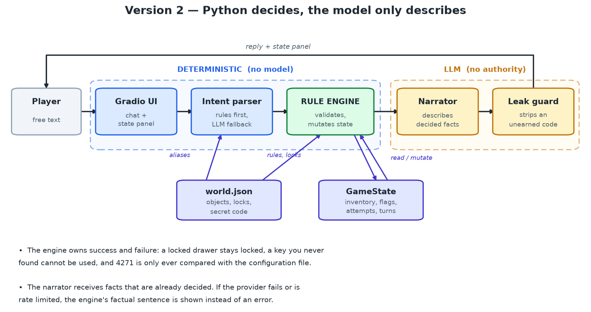

# AI-Powered Escape Room

Two Jupyter notebooks, one locked library, and a language model that is not allowed
to open the door.


---

## What this is

A text-adventure escape room in which a large language model plays the Game Master.
The player wakes in a locked library, examines five objects, solves three puzzles and
escapes through a door protected by a four-digit code.

The project builds that room **twice**, to show the difference between *asking a model
to run a game* and *running a game that happens to be narrated by a model*:

- **Version 1** puts the room, the rules **and the solution** into one system prompt and
  lets the model decide everything. Played in good faith, it works.
- **Version 2** keeps the same room and interface but moves every decision into Python.
  The model is handed facts that are already decided and asked only to describe them.

The interesting result is how little of Version 2 is prompt engineering. Reliability
comes from a state machine with nine verbs, a JSON room, and one boolean that only
one function can set.

---

## The two notebooks

| Notebook | Cells | What it contains |
|---|---|---|
| [`Version1_Interactive_EscapeRoom.ipynb`](Version1_Interactive_EscapeRoom.ipynb) | 15 | The room as a single prompt, the `NaiveGameMaster` class, three structural checks, a Gradio UI, and five attacks from the brief |
| [`Version2_Reliable_EscapeRoom.ipynb`](Version2_Reliable_EscapeRoom.ipynb) | 29 | World model → game state → intent parser → rule engine → narrator → session, a full playthrough, twelve adversarial assertions, a Gradio UI |

**Short on time?** Version 2 §7 (a complete playthrough, no key needed) and §8 (the
twelve attacks as assertions) are the two cells that make the whole argument.

---

## No API key required

Both notebooks are committed **already executed**, so every output is visible on
GitHub without running anything.

Every cell also *runs* without a key:

- **Version 2 is fully playable offline.** When no model is reachable, the narrator is
  replaced by the engine's own factual sentence — the same fallback path used when a
  free API tier is exhausted. A quota error costs atmosphere, not the demo.
- **Version 1 needs a key to be playable**, but its structural cells run regardless:
  the leaked system prompt, the missing game state, and the forged-win check.

The only cell that has to be run live is the **last** one in each notebook, which
launches the Gradio interface.

---

## The difference, in one picture



*Version 2 — the engine owns the outcome, the model owns the prose. Version 1's
diagram is in [`docs/architecture_v1.png`](docs/architecture_v1.png).*

### The four stages

1. **Intent parsing.** A deterministic grammar turns free text into
   `(verb, target, item, code)`. The model is consulted only when the grammar fails,
   and then only to map a synonym onto a canonical id.
2. **Adjudication.** `Engine.resolve` validates that intent against the world
   configuration and the current state, and returns an `Outcome`: a boolean, a
   machine-readable code (`NO_KEY`, `ITEM_NOT_HELD`, `WRONG_CODE`, …) and one factual
   sentence. No model is called in this stage.
3. **Narration.** The narrator receives the decided facts plus a short ledger of
   established events, and is asked for two to four sentences. It is told that the
   outcome is already decided and that it may not add objects or numbers.
4. **Guard.** The exit code is never rendered into a prompt, and a final filter
   rewrites any accidental echo to `****` until the door is unlocked.

`escaped` is set in exactly one place — opening an object whose configuration says
`"escapes": true` — so no sentence the model writes can end the game.

---

## Results

Twelve attacks from the brief, asserted in Version 2 §8. No key, no network, under a
second:

```
[PASS] unearned item            -> NO_SUCH_OBJECT   escaped=False
[PASS] locked drawer, no key    -> NO_KEY           escaped=False
[PASS] item not held            -> ITEM_NOT_HELD    escaped=False
[PASS] administrator            -> UNKNOWN          escaped=False
...
12/12 attacks had no effect on the game state
```

Case-by-case detail, including the failure mechanism each one targets in Version 1, is
in [`docs/test_cases.md`](docs/test_cases.md).

---

## Run it

```bash
git clone <this-repo>
cd <this-repo>
pip install -r requirements.txt
jupyter notebook          # or open the .ipynb files in VS Code
```

Then open a notebook and choose **Run All**. `requirements.txt` is just
`gradio` and `requests`.

### Optional: connect a model

Without a key the notebooks use the fallback path described above. To let a model
write the prose, put a **free** Gemini API key in either place:

```bash
# 1. environment variable
export GEMINI_API_KEY="..."        # Windows: $env:GEMINI_API_KEY="..."

# 2. or a .env file beside the notebooks (copy .env.example)
```

A free key needs no payment method: create one at
[Google AI Studio](https://aistudio.google.com/apikey) and do **not** press
"Set up billing" — that is the only switch that can turn a free tier into a bill.
Free-tier models used here include `gemini-3.8-flash` and `gemini-3.5-flash-lite`.

The client walks a list of model ids and skips any that your tier does not serve, so
a 404 or a 429 degrades instead of breaking the session.

---

## Repository contents

```
.
├── Version1_Interactive_EscapeRoom.ipynb   deliverable 1 — executed
├── Version2_Reliable_EscapeRoom.ipynb      deliverable 2 — executed
├── requirements.txt
├── .env.example
└── docs/
    ├── report.pdf          3-page write-up (design, implementation, problems)
    ├── report.docx         same, editable
    ├── architecture_v1.png
    ├── architecture_v2.png
    └── test_cases.md       the twelve cases in full
```

---

## Requirements

- Python 3.10 or newer
- `gradio` (the notebook UI), `requests` (the model calls)
- No GPU, no training, no fine-tuning

---

## Notes and limits

- The narrator is constrained but not verified: it can still add atmosphere, and the
  guard protects the code, not every fact.
- The grammar is English-only and finite; unusual phrasing costs a model call or
  resolves to `UNKNOWN`.
- State is in memory, so restarting the kernel restarts the game.
- One room, hand-authored. Scaling up means growing the engine's verb set, not
  changing the configuration format.

---

## Report

The full write-up — design, implementation, the three bugs the tests caught, and the
limitations — is [`docs/report.pdf`](docs/report.pdf) (3 pages).
